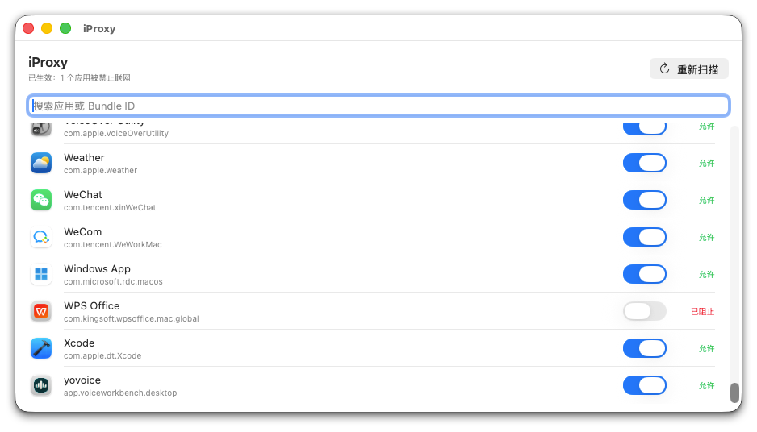
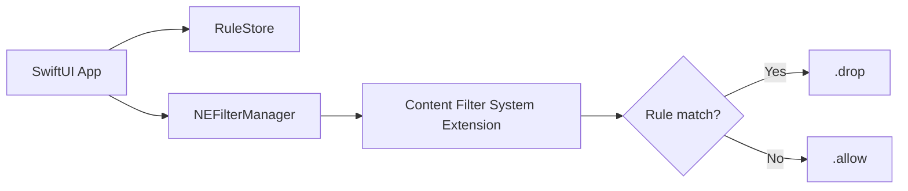

**English** | [简体中文](README.zh-CN.md)

# iProxy

Application-level network access control for macOS. List local applications and decide per app whether new TCP/UDP connections are allowed.

<p align="center">
  
</p>

<p align="center">
  <a href="docs/iproxy.mp4">Watch the 18-second demo video</a>
</p>

`macOS 13.0+` · `Universal (arm64 / x86_64)` · `SwiftUI + NetworkExtension`

> The app UI is currently in Simplified Chinese.

The core flow is implemented: turning off "Allow network access" for an app sends a rule through `NEFilterManager` to the Content Filter system extension, and new connections from that app are dropped with `.drop()`. Turning the switch back on restores access.

## Features

- Per-app network access control. The switch represents "Allow network access".
- Search by app name or bundle ID, and rescan the app list.
- Rules are stored locally and loaded again after the app restarts.
- Helper processes inside an app bundle are normalized to the outermost `.app` bundle, including common WPS, Chromium, and CEF helpers.
- Filtering is implemented with a system extension; no kernel extension is installed.
- Universal binary with arm64 and x86_64 slices for Apple Silicon and Intel Macs.

## Requirements

| Item | Requirement |
| --- | --- |
| Runtime | macOS 13.0 or later |
| Processor | Apple Silicon or Intel |
| Permissions | Install and approve the Content Filter system extension |
| Build tools | Xcode 26.6 or a compatible version |
| Distribution | Developer ID Application, Direct provisioning profile, notarization |

Intel Macs must run macOS 13.0 or later. Intel Macs that remain on macOS 12 or earlier cannot run this build.

## Installation

Obtain `iProxy.dmg` from a maintainer. If the repository publishes GitHub Releases, use the latest notarized dmg.

1. Open the dmg and drag `iProxy.app` into `/Applications`.
2. Launch `/Applications/iProxy.app`. The system extension requires the host app to be in this folder.
3. The first time you turn off "Allow network access" for an app, macOS prompts you to install the extension.
4. Open System Settings → General → Login Items & Extensions and approve the iProxy extension. An administrator password may be required.
5. The status text at the top of the window shows the number of blocked apps. New connections from a blocked app are then dropped.

Developer ID builds must be notarized and stapled. An un-notarized build reports `code signature invalid` when installing the system extension; this usually means the notarization check failed.

## Usage

The main window lists apps from `/Applications`, `/System/Applications`, `/System/Applications/Utilities`, and `~/Applications`.

- The switch is on when it is positioned to the right, which means network access is allowed.
- Turning it off blocks new connections from that app.
- The search field filters by app name or bundle ID.
- "Rescan" refreshes the app list.

Rules are stored in the app sandbox container:

```text
~/Library/Containers/org.mktime.hmccb.iProxy/Data/Library/Application Support/iProxy/rules.json
```

## How It Works



The main app does not decide each network flow. It installs the extension and publishes rules:

1. `RuleStore` persists "bundle ID → allow / drop" as JSON.
2. `FilterConfigurationService` installs the extension with `OSSystemExtensionRequest`, then writes rules into `NEFilterProviderConfiguration.vendorConfiguration` through `NEFilterManager.saveToPreferences`.
3. `FilterDataProvider` reads `vendorConfiguration["rules"]` in `startFilter`, follows configuration changes through KVO, and performs a fallback refresh every 2 seconds.
4. For each new connection, the extension uses `flow.sourceAppAuditToken` to resolve the source process. It first walks up to the outermost `.app` bundle with `SecCodeCopyPath`; if that fails, it uses the process's own signing identifier.
5. A matching rule returns `.drop()`; otherwise the extension returns `.allow()`. If the source process cannot be resolved, the connection is allowed to avoid disrupting system traffic.

The main app and the system extension both request `com.apple.developer.networking.networkextension`. Development signing uses `content-filter-provider`; Developer ID distribution uses `content-filter-provider-systemextension`. The main app also needs `com.apple.developer.system-extension.install` to install the extension.

## Build From Source

Clone the repository and run the following command from the repository root:

> This project is configured for team `HE98L3L35Z` and bundle ID `org.mktime.hmccb.iProxy`. External developers must replace the team ID and bundle ID, update the `application-identifier` values in both `*-Distribution.entitlements` files, and request the Network Extension entitlement from Apple before they can produce a working system-extension build.

```sh
xcodebuild -project iProxy.xcodeproj -scheme iProxy -configuration Debug \
  -derivedDataPath build build
```

After building, copy the app into `/Applications`. The system extension cannot be activated from `build/` or DerivedData:

```sh
osascript -e 'tell application id "org.mktime.hmccb.iProxy" to quit'
ditto build/Build/Products/Debug/iProxy.app /Applications/iProxy.app
open /Applications/iProxy.app
```

If an older iProxy instance is already running, quit it first. LaunchServices may otherwise bring the old window to the front instead of launching the new build.

Debug builds on Apple Silicon produce arm64 only by default. To distribute to Intel Macs, use the Release configuration and `scripts/package-direct.sh`, or build a universal binary explicitly.

### Tests

```sh
xcodebuild -project iProxy.xcodeproj -scheme iProxy test \
  -destination 'platform=macOS'
```

## Distribution

Developer ID distribution uses a separate signing flow:

```sh
./scripts/package-direct.sh
```

The script archives with the Release configuration, embeds the Direct provisioning profiles, re-signs the main app and system extension with Developer ID, validates entitlements and architectures, and produces:

```text
build/direct/iProxy.app
build/iProxy.zip
build/iProxy.dmg
```

Notarization is required before public distribution:

```sh
NOTARY_PROFILE=iproxy-notary ./scripts/package-direct.sh
```

See [docs/distribution.md](docs/distribution.md) for entitlement values, provisioning profiles, notarization, and verification steps. The detailed distribution guide is currently in Simplified Chinese.

## Project Layout

| Path | Description |
| --- | --- |
| `README.md` / `README.zh-CN.md` | English and Simplified Chinese documentation |
| `iProxy/` | SwiftUI app, rule storage, app scanning, and filter configuration |
| `ContentFilter/` | `NEFilterDataProvider` system extension |
| `iProxyTests/` | Swift Testing unit tests |
| `iProxyUITests/` | XCTest UI tests |
| `scripts/package-direct.sh` | Developer ID archive, re-signing, notarization, and dmg generation |
| `docs/distribution.md` | Distribution and notarization guide |

## Limitations

- Rules are matched by app only; domain, IP address, and port rules are not supported.
- Helper processes inside an app bundle are normalized by walking up the path; system processes hosted outside an app bundle may be missed.
- If the audit token or code signing identity cannot be resolved, the connection is allowed (fail open).
- The system extension requires manual approval. Re-approval may be needed after an upgrade.
- The current build supports macOS 13.0 or later only.
- Rules are stored in a local JSON file. App Group synchronization, rule import/export, and auto-update are not implemented.

## Privacy

- Rules are stored on the local Mac. The current code contains no telemetry or remote reporting.
- The system extension returns allow / drop based on the source app. It does not parse or upload network content.
- Users can revoke the extension at any time in System Settings.

## Troubleshooting

- **The system extension fails with `code signature invalid`**: Make sure the copy in `/Applications` is a notarized Developer ID build. Check `spctl -a -vvv -t exec /Applications/iProxy.app`; if it reports `Unnotarized Developer ID`, complete the notarization flow and replace the old copy with the new build.
- **The app must be in `/Applications`**: Copy it into `/Applications`, quit the old instance, and launch it again.
- **The extension stays pending approval**: Open System Settings → General → Login Items & Extensions and approve iProxy's extension. If the status shows `waiting to uninstall on reboot`, reboot the Mac once.
- **The app list is empty**: Check that the app has permission to read `/Applications` and review the app logs. An older macOS version can also cause compatibility problems.
- **Rules do not take effect**: Check the logs for "rules updated" and "blocked" entries. If there are no provider logs, the extension is not approved or not running.
- **`NSSystemExtensionUsageDescription` is missing**: Both the main app and extension Info.plist files need this key. The main app generates it through the `INFOPLIST_KEY_NSSystemExtensionUsageDescription` build setting.

View logs:

```sh
log stream --predicate 'subsystem == "org.mktime.hmccb.iProxy"' --level info
```

## Feedback

When reporting an issue, include the macOS version, processor architecture, iProxy version, reproduction steps, and relevant logs. For system extension installation failures, also include the output of `systemextensionsctl list` and `codesign --verify --verbose=4 /Applications/iProxy.app`.

## License

This project is licensed under the [MIT License](LICENSE).
