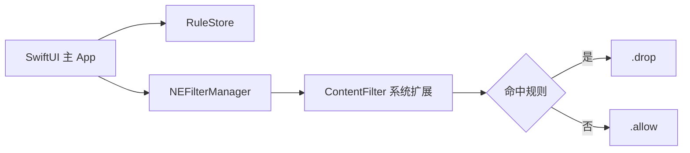

[English](README.md) | **简体中文**

# iProxy

macOS 应用级网络访问控制工具。列出本机应用，按应用决定是否允许新发起的 TCP/UDP 连接。

<p align="center">
  
</p>

<p align="center">
  <a href="docs/iproxy.mp4">观看演示视频（18 秒）</a>
</p>

`macOS 13.0+` · `Universal (arm64 / x86_64)` · `SwiftUI + NetworkExtension`

当前版本已经跑通核心闭环：关闭某个应用的「允许访问网络」开关后，规则经 `NEFilterManager` 下发给 Content Filter 系统扩展，该应用新发起的连接被 `.drop()`；重新打开开关后恢复放行。

## 功能

- 按应用开关网络访问，开关语义为「允许访问网络」。
- 支持搜索应用名称或 Bundle ID，支持重新扫描应用列表。
- 规则保存在本机，重新启动 App 后仍会加载。
- 自动识别 App 内的辅助进程，例如 WPS、Chromium 和 CEF 的 helper，按最外层 `.app` 归一。
- 使用系统扩展实现过滤，不安装内核扩展。
- 提供 arm64 和 x86_64 通用二进制，支持 Apple Silicon 与 Intel Mac。

## 系统要求

| 项目 | 要求 |
| --- | --- |
| 运行系统 | macOS 13.0 或更高版本 |
| 处理器 | Apple Silicon 或 Intel |
| 权限 | 安装并批准 Content Filter 系统扩展 |
| 构建工具 | Xcode 26.6 或兼容版本 |
| 分发签名 | Developer ID Application、Direct 配置描述文件、公证 |

Intel Mac 需要运行 macOS 13.0 或更高版本。停在 macOS 12 或更早版本的 Intel Mac 不能运行当前构建。

## 安装

从维护者提供的发布包获取 `iProxy.dmg`。如果仓库发布了 GitHub Releases，优先使用最新版本中完成公证的 dmg。

1. 打开 dmg，把 `iProxy.app` 拖入 `/Applications`。
2. 从 `/Applications/iProxy.app` 启动。系统扩展要求宿主 App 位于这个目录。
3. 首次关闭某个应用的「允许访问网络」开关时，系统会提示安装扩展。
4. 到「系统设置 → 通用 → 登录项与扩展」批准 iProxy 的扩展，可能需要管理员密码。
5. 顶部状态文案显示「已生效：N 个应用被禁止联网」后，目标应用的新连接会被拦截。

Developer ID 分发包必须完成公证和票据装订。未公证的包在安装系统扩展时会报 `code signature invalid`，这个提示通常表示系统扩展的公证校验没有通过。

## 使用方式

主界面列出 `/Applications`、`/System/Applications`、`/System/Applications/Utilities` 和用户 `~/Applications` 中的应用。

- 开关位于右侧时表示允许访问网络。
- 关闭开关后，该应用新发起的连接会被拦截。
- 搜索框可以按应用名称或 Bundle ID 过滤列表。
- 「重新扫描」用于刷新应用列表。

规则保存在 App 沙盒容器内：

```text
~/Library/Containers/org.mktime.hmccb.iProxy/Data/Library/Application Support/iProxy/rules.json
```

## 工作原理



主 App 不参与每条网络流的判定，只负责安装扩展和下发规则：

1. `RuleStore` 把「Bundle ID → allow / drop」保存为 JSON。
2. `FilterConfigurationService` 使用 `OSSystemExtensionRequest` 安装扩展，再通过 `NEFilterManager.saveToPreferences` 把规则写入 `NEFilterProviderConfiguration.vendorConfiguration`。
3. 扩展进程 `FilterDataProvider` 在 `startFilter` 读取 `vendorConfiguration["rules"]`，之后通过 KVO 跟随配置变化，并有 2 秒一次的兜底刷新。
4. 新连接到来时，扩展使用 `flow.sourceAppAuditToken` 反查来源进程。先用 `SecCodeCopyPath` 回溯到最外层 `.app` 取得 Bundle ID，拿不到时再使用进程自身的签名标识。
5. 命中规则返回 `.drop()`，否则返回 `.allow()`。无法解析来源进程时放行，避免误伤系统流量。

主 App 和系统扩展都申请了 `com.apple.developer.networking.networkextension`。开发签名使用 `content-filter-provider`，Developer ID 分发使用 `content-filter-provider-systemextension`。主 App 另外需要 `com.apple.developer.system-extension.install` 才能安装扩展。

## 从源码构建

克隆仓库后，在仓库根目录执行：

> 当前工程固定使用开发团队 `HE98L3L35Z` 和 Bundle ID `org.mktime.hmccb.iProxy`。外部开发者需要替换 Team ID、Bundle ID，更新两个 `*-Distribution.entitlements` 中的 `application-identifier`，并向 Apple 申请 Network Extension 权限，才能生成可用的系统扩展构建。

```sh
xcodebuild -project iProxy.xcodeproj -scheme iProxy -configuration Debug \
  -derivedDataPath build build
```

构建完成后，把 App 复制到 `/Applications`。系统扩展不能从 `build/` 或 DerivedData 直接激活：

```sh
osascript -e 'tell application id "org.mktime.hmccb.iProxy" to quit'
ditto build/Build/Products/Debug/iProxy.app /Applications/iProxy.app
open /Applications/iProxy.app
```

如果已经有一个正在运行的 iProxy，先退出旧实例，否则 LaunchServices 可能只会把旧窗口调到前台。

Debug 构建在 Apple Silicon 上默认只生成 arm64。需要分发给 Intel Mac 时，使用 Release 配置和 `scripts/package-direct.sh`，或者显式构建通用二进制。

### 测试

```sh
xcodebuild -project iProxy.xcodeproj -scheme iProxy test \
  -destination 'platform=macOS'
```

## 分发

Developer ID 分发需要一个独立的签名流程：

```sh
./scripts/package-direct.sh
```

脚本会使用 Release 配置归档，嵌入 Direct 配置描述文件，用 Developer ID 重签主 App 和系统扩展，校验权限和架构，并生成：

```text
build/direct/iProxy.app
build/iProxy.zip
build/iProxy.dmg
```

对外分发前必须完成公证：

```sh
NOTARY_PROFILE=iproxy-notary ./scripts/package-direct.sh
```

详细的权限值、配置描述文件、公证和校验步骤见 [docs/distribution.md](docs/distribution.md)。

## 项目结构

| 路径 | 说明 |
| --- | --- |
| `README.md` / `README.zh-CN.md` | 英文与简体中文文档 |
| `iProxy/` | SwiftUI 主 App、规则存储、应用扫描和过滤器配置 |
| `ContentFilter/` | `NEFilterDataProvider` 系统扩展 |
| `iProxyTests/` | Swift Testing 单元测试 |
| `iProxyUITests/` | XCTest 界面测试 |
| `scripts/package-direct.sh` | Developer ID 归档、重签、公证和 dmg 生成 |
| `docs/distribution.md` | 分发与公证说明 |

## 已知限制

- 只支持按应用匹配，不支持按域名、IP 地址或端口配置规则。
- 嵌套在 App 包内的辅助进程通过回溯源路径归一；宿主在 App 包之外的系统进程可能漏判。
- 无法取得 audit token 或代码签名标识时采用 fail open，不会拦截该连接。
- 需要用户手动批准系统扩展。升级版本后可能需要重新批准。
- 当前只支持 macOS 13.0 或更高版本。
- 当前使用本地 JSON 保存规则，尚未实现 App Group 同步、规则导入导出和自动更新。

## 隐私

- 规则只保存在本机，当前代码没有遥测或远程上报逻辑。
- 系统扩展根据来源应用返回 allow / drop，不解析或上传网络内容。
- 用户可以随时在系统设置中撤销扩展权限。

## 故障排查

- **系统扩展安装失败并提示 `code signature invalid`**：确认 `/Applications` 中使用的是完成公证的 Developer ID 产物。查看 `spctl -a -vvv -t exec /Applications/iProxy.app` 是否显示 `Unnotarized Developer ID`，必要时重新执行公证流程，并用新产物替换旧副本。
- **提示必须位于 `/Applications`**：把 App 复制到 `/Applications` 后再启动，并先退出旧实例。
- **扩展一直等待批准**：打开「系统设置 → 通用 → 登录项与扩展」，允许 iProxy 的扩展。如果状态显示 `waiting to uninstall on reboot`，重启一次 Mac。
- **列表为空**：确认 App 有读取 `/Applications` 的权限，并查看应用日志。系统版本过低时也会出现兼容性问题。
- **设置规则后不生效**：查看日志中是否出现「规则已更新」和「拦截」记录。没有 provider 日志通常表示扩展未获批准或未运行。
- **提示缺少 `NSSystemExtensionUsageDescription`**：主 App 和扩展的 Info.plist 都需要这个键。主 App 通过 `INFOPLIST_KEY_NSSystemExtensionUsageDescription` 构建设置生成。

查看日志：

```sh
log stream --predicate 'subsystem == "org.mktime.hmccb.iProxy"' --level info
```

## 反馈

提交问题时请附上 macOS 版本、处理器架构、iProxy 版本、复现步骤和相关日志。涉及系统扩展安装失败时，同时提供 `systemextensionsctl list` 和 `codesign --verify --verbose=4 /Applications/iProxy.app` 的输出。

## License

本项目采用 [MIT License](LICENSE)。
